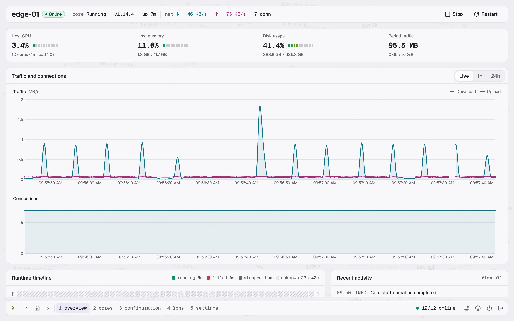
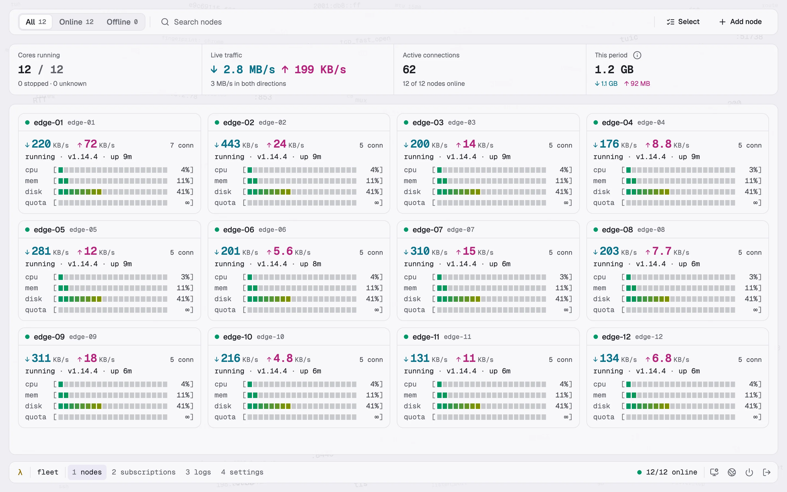
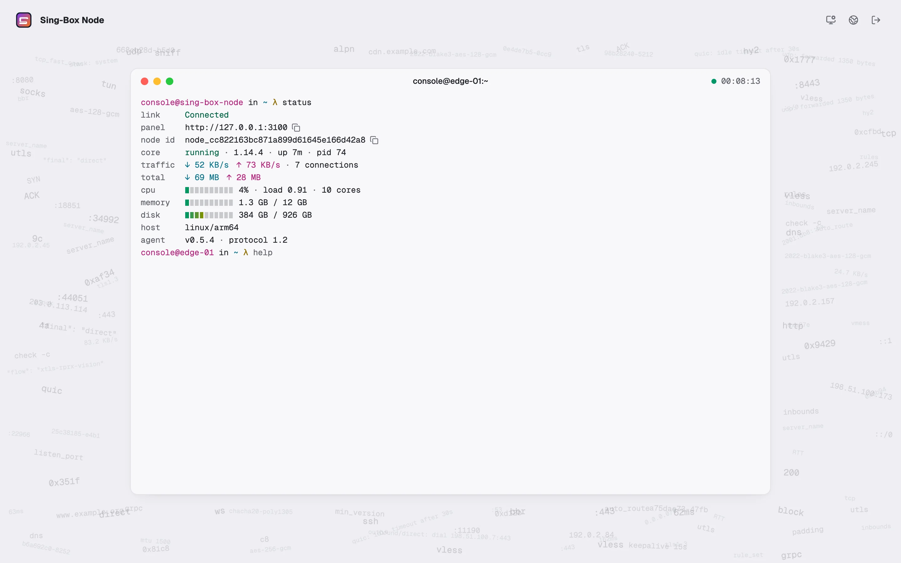

<div align="center">
  
  <h1>sing-box-panel</h1>
  <p>A Linux control plane for a fleet of exact, verifiable sing-box runtimes.</p>
  <div>
    
    
    
    <a href="LICENSE"></a>
  </div>
  <div>
    <a href="#features">Features</a> ·
    <a href="#deploy">Deploy</a> ·
    <a href="#uninstall-and-clean-up">Uninstall</a> ·
    <a href="#documentation">Documentation</a> ·
    <a href="https://github.com/rehuony/sing-box-panel/issues">Issues</a>
  </div>
</div>

<br>

<picture>
  <source media="(prefers-color-scheme: dark)" srcset="docs/images/panel-node-overview-dark.webp">
  
</picture>

sing-box-panel manages sing-box on any number of Linux hosts from one panel.
The panel, `sing-box-panel`, holds every node's configuration, the core
versions, subscriptions and the fleet's telemetry, and runs no sing-box itself.
A node, `sing-box-node`, runs one exact sing-box version on its host, reports
its state and carries out the panel's commands. Both are static Go executables
with their Web interfaces built in, so a host needs no Go, Node.js or database
server.

<table>
  <tr>
    <td width="50%">
      <picture>
        <source media="(prefers-color-scheme: dark)" srcset="docs/images/panel-nodes-dark.webp">
        
      </picture>
    </td>
    <td width="50%">
      <picture>
        <source media="(prefers-color-scheme: dark)" srcset="docs/images/node-console-dark.webp">
        
      </picture>
    </td>
  </tr>
  <tr>
    <td align="center">The fleet in the panel</td>
    <td align="center">A node's own console</td>
  </tr>
</table>

## Features

- **One panel, many nodes.** Nodes enroll with a one-time code and their own
  Ed25519 key, dial out to the panel over WebSocket through its HTTPS address,
  and keep running their configuration while the panel is away.
- **Exact sing-box versions.** Install official or imported sing-box builds by
  exact version for amd64 or arm64. The panel downloads and verifies each archive
  once, and nodes install it from the panel.
- **Checked configuration.** Each node has one sing-box JSON document, checked
  with the node's own binary before it runs and edited in a form built from the
  schema of its sing-box release line.
- **Subscriptions.** Publish authorized subscriptions in sing-box, Mihomo and
  Loon formats from a pool of fleet nodes and third-party sources, with
  per-channel groups and routing rules.
- **Live operations.** Live traffic and connections, per-node quotas and
  periods, a runtime timeline, the panel's log and each node's events and core
  log, and batch start, stop, restart and update from the panel or its command
  line.
- **Signed one-way updates.** The panel and its nodes update themselves to a
  newer signed release from the interface or the command line, and their
  systemd units install it before the service starts again.

Supported hosts are Linux on amd64 and arm64.

## Deploy

**1. Install the panel** on its host as root and start its service. Installing
the service creates its settings and prints the administrator's email and
password once.

```sh
curl -fsSL https://raw.githubusercontent.com/rehuony/sing-box-panel/main/scripts/installer.sh | sudo bash -s -- --component panel
sudo sing-box-panel systemd install --scope=system --now
```

The installer verifies the release signature and the binary's checksum and
writes only the binary; see [scripts](scripts/README.md#release-installer).

**2. Publish it over HTTPS.** The panel listens on `127.0.0.1:3000`. Put a
reverse proxy with a trusted certificate in front of it on the same host, as in
[Behind Nginx](docs/configuration-and-runtime.md#behind-nginx), then set the
public origin so nodes on other hosts can reach it:

```sh
sudo sing-box-panel config set server.external_origin https://panel.example.com
sudo sing-box-panel systemd restart
```

**3. Add a node.** Choose *Add node* in the panel and copy its command. On the
node's host:

```sh
curl -fsSL https://raw.githubusercontent.com/rehuony/sing-box-panel/main/scripts/installer.sh | sudo bash -s -- --component node
sudo sing-box-node systemd install --scope=system --now
sudo sing-box-node enroll --code sbp2....
```

**4. Run sing-box.** In the node's *cores* window install a sing-box version,
write its configuration in *configuration*, and start it from the node's title
strip.

**5. Publish subscriptions** from *subscriptions*; see
[Subscriptions and observability](docs/subscriptions-and-observability.md).

**6. Update** the panel from its settings and each node from its own, or run
`sudo sing-box-panel update` and `sudo sing-box-node update`. Nodes always
follow the panel's release.

[Getting started](docs/getting-started.md) covers each step, a regular user's
installation and running from a source build.

## Uninstall and clean up

`cleanup.sh` lists what sing-box-panel and sing-box-node left on a host,
including what earlier releases left behind, and removes it. It changes nothing
until asked:

```sh
# List the installation, leftovers of earlier releases, and what needs attention
curl -fsSL https://raw.githubusercontent.com/rehuony/sing-box-panel/main/scripts/cleanup.sh | sudo bash

# Remove only what earlier releases and interrupted updates left behind
curl -fsSL https://raw.githubusercontent.com/rehuony/sing-box-panel/main/scripts/cleanup.sh | sudo bash -s -- legacy

# Stop and remove the services, binaries, settings, data and service accounts
curl -fsSL https://raw.githubusercontent.com/rehuony/sing-box-panel/main/scripts/cleanup.sh | sudo bash -s -- purge
```

Add `--component panel` or `--component node` to act on one, `--keep-data` to
keep settings and data through a purge, and `--yes` to skip the confirmation.
See [scripts](scripts/README.md#cleanup) for what it finds.

## Build from source

Building needs Go 1.26, Node.js 22.12 or newer and Corepack with the pinned
pnpm 11.21.0:

```sh
make deps
make check build
./bin/sing-box-panel server start --config ./setting.json
```

`make build` writes `bin/sing-box-panel` and `bin/sing-box-node` with their Web
interfaces; plain `make` lists every target. See
[Contributing](.github/CONTRIBUTING.md#validation) for focused checks.

## Documentation

| Workflow | Guide |
| --- | --- |
| Install, run and update the panel and nodes | [Getting started](docs/getting-started.md) |
| Use the commands, their output and shell completion | [CLI reference](docs/cli.md) |
| Run the services under systemd | [systemd packaging](docs/systemd.md) |
| Install core versions and their release-line capabilities | [Core versions](docs/core-versions.md) |
| Edit, check, apply and restart configuration | [Configuration and runtime](docs/configuration-and-runtime.md) |
| Publish subscriptions and read operational data | [Subscriptions and observability](docs/subscriptions-and-observability.md) |
| Understand the panel and nodes, their protocol and state | [Panel and node architecture](docs/panel-node-architecture.md) |
| Integrate with the API and its security boundary | [HTTP API and security](docs/architecture.md#http-api-and-security) |
| Build, sign, test and publish releases | [Release process](docs/release.md) |

The [documentation index](docs/README.md) also links the contracts and the
component-level references.

## Project map

```text
.github/             Workflows, community templates, code ownership, and signing keys
api/                 HTTP (OpenAPI) and panel–node (protobuf) contracts
cmd/                 The panel and node binaries' main.go files
docs/                Guides, architecture, testing, packaging, release process and README images
internal/            Go packages: sing-box-panel/ and sing-box-node/ per service, shared ones beside them
scripts/             Installation, cleanup, release and local test scripts
tools/               Maintainer commands run through go tool
web/                 pnpm workspace: the panel and node console React applications and their shared package
DESIGN.md            Visual identity, design tokens, and interface rules
```

## Contributing

Read the [contribution guide](.github/CONTRIBUTING.md) before opening an issue or pull
request. Participation is governed by the [Code of Conduct](.github/CODE_OF_CONDUCT.md),
and vulnerabilities must be reported privately according to the
[Security Policy](.github/SECURITY.md).

## License

sing-box-panel is licensed under GPL-3.0-or-later. See the concise
[license summary](LICENSE), the complete [GPLv3 text](COPYING), and the
[third-party notices](THIRD_PARTY_NOTICES).
